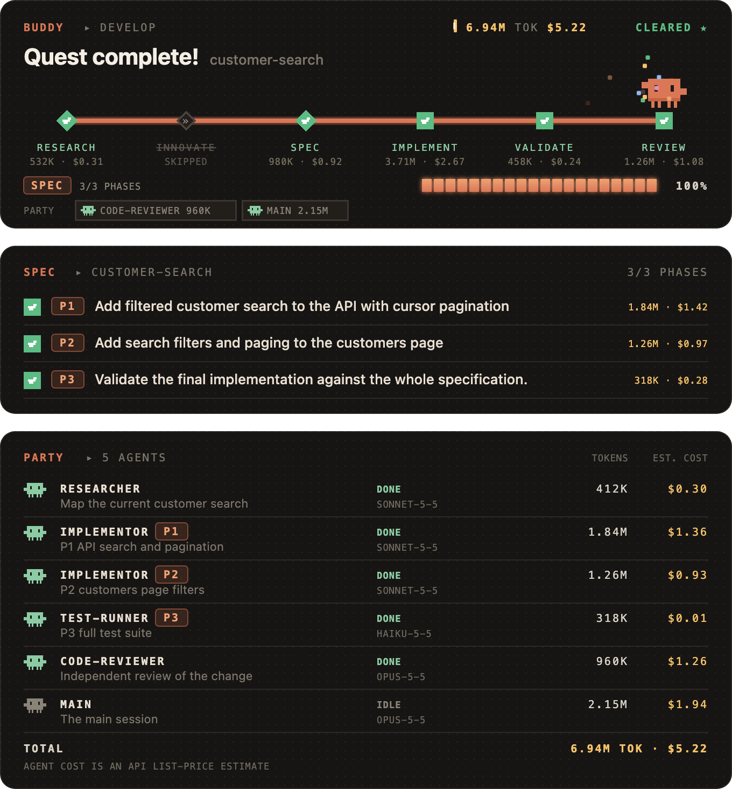

<h1 align="center">Buddy</h1>

<p align="center">
  <strong>Plan the work. Control the context. Ship with proof.</strong><br>
  A development workflow plugin for Codex, Claude Code, and Cursor that takes a change from idea to reviewed, verified code.
</p>

<p align="center">
  <a href="https://github.com/leszekgruchala/buddy/releases"></a>
  <a href="#install-and-update"></a>
  <a href="https://agentskills.io"></a>
  <a href="LICENSE"></a>
</p>

<p align="center">
  <a href="#quick-start">Quick start</a> ·
  <a href="#what-it-does">What it does</a> ·
  <a href="#install-and-update">Install</a> ·
  <a href="#usage">Usage</a> ·
  <a href="#how-it-works">How it works</a> ·
  <a href="#requirements">Requirements</a> ·
  <a href="#limits">Limits</a>
</p>

<p align="center">
  
  <br>
  <sub>The <code>develop</code> workflow. Buddy runs only the stages a task needs and finishes when validation and review pass.</sub>
</p>

---

Ask a coding agent for a feature and it usually investigates, decides, edits, and checks inside one growing conversation, then tells you the change *should* work. Ask Buddy to `Develop customer search with filters and pagination` and you get a short research brief, a specification with numbered success criteria, focused implementation phases checked against those criteria, and an independent code review that sends real findings back for a fix.

Each stage writes its result to a worklog in your repository, so the next stage starts from facts on disk instead of a long chat history. A narrow fix goes straight to implementation; larger or unclear work gets research and a spec first.

## Quick start

Install Buddy in Claude Code:

```bash
claude plugin marketplace add leszekgruchala/buddy@main
```

```bash
claude plugin install buddy@buddy
```

Run `/reload-plugins` or restart Claude Code, then describe the outcome you want:

> Develop customer search with filters and pagination

That's it. You do not configure models or API keys: Buddy uses the models your coding tool already offers. Using Codex or Cursor? See [Install and update](#install-and-update).

## What it does

| Skill | What you get | Try |
|---|---|---|
| [`develop`](skills/develop/SKILL.md) | A complete change, from research to verified and reviewed code. | `Develop customer search with filters and pagination` |
| [`brainstorm`](skills/brainstorm/SKILL.md) | A discussion that tests an idea, kept in one living document. | `Brainstorm a neighborhood tool-sharing service with me` |
| [`research`](skills/research/SKILL.md) | A short brief of current facts, evidence, open questions, and rejected ideas. No code changes. | `Research how customer search currently works` |
| [`innovate`](skills/innovate/SKILL.md) | Different solution directions and their trade-offs, added to a passed research brief. | `Compare ways to add pagination to customer search` |
| [`spec`](skills/spec/SKILL.md) | A phased plan with requirements, success criteria, and verification. | `Create a spec for customer search with filters and pagination` |
| [`implement`](skills/implement/SKILL.md) | A narrow fix, or one approved spec run with verification. | `/implement .ai/worklog/20260804_customer-search/spec_customer-search.md` |
| [`test-runner`](skills/test-runner/SKILL.md) | The relevant tests, lint, type checks, and builds, run and reported. | `Run the tests affected by my change` |
| [`review-code`](skills/review-code/SKILL.md) | Independent, evidence-backed findings for a local change. | `/review-code` |
| [`change-report`](skills/change-report/SKILL.md) | An HTML report that explains a PR or branch diff and its impact. | `Use change-report to explain PR #123 and its impact` |
| [`archive-worklogs`](skills/archive-worklogs/SKILL.md) | Old worklogs moved into yearly archive folders. | `Archive worklogs older than 30 days` |

### See progress live in Claude Code

<p align="center">
  
  <br>
  <sub>The Buddy mod after a <code>develop</code> run, with the details pane open.</sub>
</p>

When a Buddy skill runs in Claude Code, a band above the prompt shows:

- the stage track from Research to Review, with skipped stages marked;
- the spec phase in work and a progress bar from its tasks;
- the subagents working on the stage;
- tokens and cost for the run, per stage and per phase, plus the run's total cached reads.

Token counts show new tokens: input, output, and cache writes. Cached reads are shown apart, because each request reads the whole cached conversation again, and their sum grows with the number of requests, not with the work done. The cost still includes them.

Select **Details**, or run `/buddy-mod`, to open a pane with every phase, its task checklist, and each subagent's input, output, total, and cached tokens with its estimated cost. **Hide** removes the band until the next Buddy run. The mod reads only events Claude Code already reports and adds nothing to your prompts or context.

<details>
<summary><strong>Turn the Buddy mod off or on</strong></summary>
<br>

The mod is on by default, also when you update an installed Buddy. To turn off only the mod, set the Buddy option **Show the Buddy mod** to off. Buddy's skills, agents, and hooks keep working. Use one of these:

- In a Claude Code terminal session, run `/plugin configure buddy@buddy`, or change the **Show the Buddy mod** row in `/config`. Claude Code reloads Buddy with the new value when you save.
- From your shell, run the command below. Claude Code applies it in your next session, in the terminal and in the Desktop app.

```bash
echo '{"show_mod":"false"}' | claude plugin configure buddy@buddy --values-stdin
```

To turn the mod on again, set the option back to on, or run the same command with `"true"`. `claude plugin install` reports this option as `not yet set` until you choose a value; the mod stays on until then. To turn off all mods, use [the mod controls](https://code.claude.com/docs/en/plugins/mods/overview#turn-mods-on-or-off).

</details>

### Explain a code change

[`change-report`](skills/change-report/SKILL.md) turns a pull request or branch diff into a short HTML report: what changed, why, who is affected, and which actions matter.

> Use change-report to compare branch feature/customer-search with main

Reports group changes by feature in a **Before / After / Impact** table with source evidence. **High risk**, **Breaking change**, and **Human review** markers show what needs attention and the next action. When wiring or execution flow changes, **Before / After** diagram tabs and an **Execution flow** view show the affected connections; small changes skip diagrams. Reports work offline and are saved in the change's `.ai/worklog/` folder.

[Open the interactive sample report](https://gruchala.eu/buddy/examples/change-report.html), or [get its self-contained HTML file](docs/examples/change-report.html) for local use. The sample is a frozen development example.

### Review and learn from findings

Run `/review-code` for an independent review of a local change. It returns findings with severity, evidence, and a fix, and does not edit your code. `develop` runs the same review after implementation, sends open findings back for a fix, and reviews again, for at most two rounds. When a fix is confirmed, the reviewer can add a short prevention rule to `.ai/memory/memory.md` that later specs and implementations read as advice.

### Destructive-command guard

Buddy bundles a shell guard that blocks destructive infrastructure, container, cloud, database, SQL, and unsafe file-removal commands before they run. Agents can still remove explicit files inside your current Git worktree. When the guard blocks a command, the agent stops and gives you the exact command to review and run yourself. When it blocks a shell heredoc that writes a file, the agent writes the file with its file-edit tool and runs the other commands without the heredoc.

The guard runs on macOS 10.15 or newer and needs `zsh`, `jq`, and `git`. If one of them is missing, the guard blocks shell commands until you install it.

To check that the guard is active, ask the agent to run `terraform apply -help`. Buddy should block it before Terraform starts. In Cursor Cloud Agents, the guard might not run, because Cursor does not yet document plugin hooks as available there.

## Install and update

<details>
<summary><strong>Claude Code</strong>: install and update</summary>
<br>

**Install:** Add the marketplace and install Buddy from an interactive Claude Code session or your terminal:

```bash
claude plugin marketplace add leszekgruchala/buddy@main
claude plugin install buddy@buddy
```

**Update:**

```bash
claude plugin marketplace update buddy
claude plugin update buddy@buddy
```

Restart Claude Code, or run `/reload-plugins`, before starting work with Buddy. The shared `PreToolUse` hook is installed automatically.

</details>

<details>
<summary><strong>Codex</strong>: install and update, desktop and CLI</summary>
<br>

On the same machine with the same Codex configuration, desktop and CLI share plugin settings and installed files. Use these terminal commands for either client. See the [Codex plugin documentation](https://developers.openai.com/plugins/build/plugins).

**Install:** Add Buddy's GitHub repository as a marketplace once, then install the plugin:

```bash
codex plugin marketplace add leszekgruchala/buddy --ref main
codex plugin add buddy@buddy
```

**Update:**

```bash
codex plugin marketplace upgrade buddy
```

After installation or update, restart Codex desktop or start a new CLI session. Buddy appears in desktop **Plugins** under the **buddy** marketplace. Review and trust Buddy's `PreToolUse` hook if prompted, using `/hooks` in the CLI or the desktop app.

</details>

<details>
<summary><strong>Cursor</strong>: install and update</summary>
<br>

**Install from the Git marketplace:** Register Buddy's repository in the IDE: open **Customize → Plugins**, select **Add Marketplace → Import from GitHub**, and enter `https://github.com/leszekgruchala/buddy`. Or register it from your terminal:

```bash
cursor agent plugin marketplace add https://github.com/leszekgruchala/buddy
```

Open **Customize → Plugins**, find Buddy in the registered marketplace, and select **Install**.

**Update:**

```bash
cursor agent plugin marketplace remove buddy
cursor agent plugin marketplace add https://github.com/leszekgruchala/buddy
```

Then use `/plugin` to add Buddy, or open **Customize → Browse Marketplace → Add Buddy**. Reload the IDE window or restart Cursor.

During `implement`, Buddy tries to open a native Cursor Goal for the run, so you can track it without typing a goal. If Cursor refuses, Buddy keeps a checklist instead and continues. Say that you do not want Goal tracking to opt out. See [Cursor Goal tracking](docs/workflow.md#cursor-goal-tracking) for details.

</details>

## Usage

Describe the result you want and let `develop` coordinate the work:

> Develop customer search with filters and pagination

For the best results:

1. **Describe the outcome, not the steps.** `develop` picks the stages the task needs. It always validates and reviews implementation changes, and finishes only when both pass.
2. **Run one stage when that is all you need.** `research`, `innovate`, `spec`, and `implement` stop after their own stage and stay active for follow-up questions. Ask for research when you need only facts, or for a spec when you want to approve the plan before code changes.
3. **Run an approved spec later.** Each piece of work has a folder in `.ai/worklog/`. Pass its spec to `/implement` to build it in a new session.
4. **Name a model only when you care.** Buddy recommends a fast, balanced, or frontier tier per stage and your tool picks the model. Your request overrides that:

   > Develop customer search with filters and pagination. Use MODEL for review.

   See [Model selection](docs/workflow.md#model-selection) for the full rules.

## How it works

- [`skills/`](skills): one Agent Skills folder per stage. [`develop`](skills/develop/SKILL.md) coordinates the others.
- [`agents/`](agents): subagents for research, innovation, implementation, testing, and review. Each stage runs with only the context it needs.
- [`hooks/`](hooks): the destructive-command guard, shared by all three tools.
- [`claude/buddy-mod/`](claude/buddy-mod): the Claude Code progress mod.
- [docs/workflow.md](docs/workflow.md): stage contracts, research and spec formats, review rules, and model selection.
- [docs/harness-compatibility.md](docs/harness-compatibility.md): what each tool supports.

Buddy writes these files to your project:

| Path | Contents |
|---|---|
| `.ai/worklog/<yyyyMMdd>_<work-name>/` | Research brief, spec, and change reports for one piece of work. |
| `.ai/worklog/archive/<yyyy>/` | Worklogs moved by `archive-worklogs`. |
| `.ai/memory/memory.md` | Prevention rules confirmed by code review. |
| `docs/brainstorming/<YYYY-MM-DD>-<idea-slug>.md` | One living document per brainstormed idea. |

## Requirements

| Requirement | Needed by | Notes |
|---|---|---|
| Codex, Claude Code, or Cursor | Buddy | Install from each tool's plugin marketplace. |
| macOS 10.15 or newer | Destructive-command guard | |
| `zsh`, `jq`, `git` | Destructive-command guard | Without them, the guard blocks shell commands. |
| Claude Code v2.1.287 or later (terminal), v2.1.286 or later (Desktop app) | Buddy mod | Codex and Cursor do not load the mod. |
| Python 3 | `change-report`, `archive-worklogs` | Uses only the standard library. |

## Limits

- Buddy provides workflow guardrails, not a security boundary. Your coding tool's sandbox, permissions, and approval system remain authoritative.
- In Cursor Cloud Agents, the destructive-command guard might not run.
- The Buddy mod shows only in a Claude Code session displayed on its own, not in a split-view pane. Subagent costs are estimates at API list prices; the run total comes from Claude Code's own session cost.
- `develop` runs at most two fix and re-review rounds. If findings stay open, it stops as blocked and reports them.
- Cursor can refuse a Goal request. Buddy then tracks the run with a checklist.
- If a requested model or tier cannot run in your tool, Buddy reports it and does not substitute another.

## Contributing

Report bugs and ideas in [GitHub issues](https://github.com/leszekgruchala/buddy/issues). See [releases](https://github.com/leszekgruchala/buddy/releases) for what changed in each version.

## License

[Elastic License 2.0](LICENSE).
