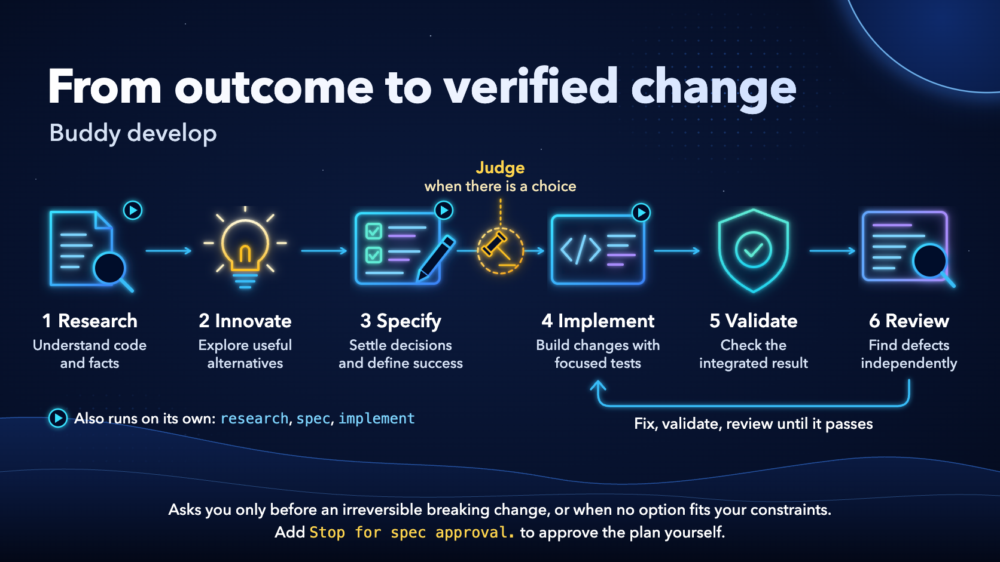

<h1 align="center">Buddy</h1>

<p align="center">
  <strong>Plan the work. Control the context. Ship with proof.</strong><br>
  A development workflow plugin for Codex, Claude Code, and Cursor that matches the work to the right planning, review, and verification steps.
</p>

<p align="center">
  <a href="https://github.com/leszekgruchala/buddy/releases"></a>
  <a href="#install-and-update"></a>
  <a href="https://agentskills.io"></a>
  <a href="LICENSE"></a>
</p>

<p align="center">
  <a href="#quick-start">Quick start</a> ·
  <a href="#usage">Usage</a> ·
  <a href="#install-and-update">Install</a> ·
  <a href="#requirements">Requirements</a>
</p>

<p align="center">
  
  <br>
  <sub>The <code>develop</code> workflow runs on its own and asks you only when it must.</sub>
</p>

---

Ask Buddy to `Develop customer search with filters and pagination` and it finishes the work on its own: research, a spec, implementation with focused tests, validation, and independent review. Review findings go back to implementation, and Buddy fixes, validates, and reviews again until the work passes. An independent judge settles the spec's choices, so Buddy asks you only before an irreversible breaking change that you did not request, or when no option fits your constraints.

You keep control. Add `Stop for spec approval.` to approve the plan yourself, or run one skill, such as `research`, `spec`, or `implement`, when you want only that step.

Each stage writes its result to a worklog in your repository, so the next stage starts from facts on disk instead of a long chat history. Buddy scales the workflow to the change: a narrow fix goes straight to implementation, trivial edits need no independent review, and larger or unclear work gets research, a spec, and the full review loop.

## Quick start

Install Buddy in Claude Code directly from GitHub. Run both commands in your terminal.

```bash
claude plugin marketplace add leszekgruchala/buddy@main
claude plugin install buddy@buddy
```

Run `/reload-plugins` in Claude Code or start a new session. Then try this prompt in your project.

> Develop customer search with filters and pagination

Buddy uses the models your coding tool already offers.

<details>
<summary><strong>Install with the Buddy CLI</strong></summary>

Use this option to manage Buddy across coding tools. It requires Node.js 22.12 or later and installs from GitHub.

```bash
npm install --global github:leszekgruchala/buddy#main
buddy install --agent claude
```

Then run `/reload-plugins` or start a new Claude Code session. If npm skips lifecycle scripts, see [Run the CLI from a checkout](docs/development.md#run-the-cli-from-a-checkout).

</details>

For Codex, Cursor, and updates, see [Install and update](#install-and-update).

## Usage

Describe the outcome you want, not the steps. `develop` picks the stages the task needs.

| Skill | What you get | Try |
|---|---|---|
| [`develop`](skills/develop/SKILL.md) | End-to-end workflow. A complete change, from research to verified and reviewed code. When the spec has choices or irreversible-change risks, an independent judge settles them, so Buddy asks you only before an irreversible breaking change that you did not request, or when no option fits your constraints. | `Develop customer search with filters and pagination`<br><br>`Develop customer search with filters and pagination. Stop for spec approval.`<br><br>`Develop everything in @tasks.md`<br> |
| [`research`](skills/research/SKILL.md) | A short brief of verified facts, evidence, open questions, and rejected ideas. Buddy tests the premise of your request and keeps looking past the first plausible answer. No code changes. | `Research how customer search currently works` |
| [`innovate`](skills/innovate/SKILL.md) | The best viable solution directions, their trade-offs, and a recommendation, added to a passed research brief. | `Compare ways to add pagination to customer search` |
| [`spec`](skills/spec/SKILL.md) | A phased plan with the options it compared, requirements, success criteria, and verification. | `Create a spec for customer search with filters and pagination` |
| [`implement`](skills/implement/SKILL.md) | A narrow fix, or one approved spec run with verification. | `Fix the off-by-one error in the pagination total`<br><br>`Implement @spec_customer-search.md` |
| [`review-code`](skills/review-code/SKILL.md) | Independent, evidence-backed findings for a local change, with memory: confirmed fixes become prevention rules in `.ai/memory/memory.md` that later specs and implementations read. | `Review my uncommitted changes` |

Buddy recommends a model tier per stage and your coding tool picks the model. A model you name in the request overrides that. See [Model selection](docs/workflow.md#model-selection).

### Supporting skills

Run these when you need one specific task done.

| Skill | What you get | Try |
|---|---|---|
| [`brainstorm`](skills/brainstorm/SKILL.md) | A discussion that tests an idea, kept in one living document. | `Brainstorm a neighborhood tool-sharing service with me` |
| [`judge`](skills/judge/SKILL.md) | An independent ruling on each choice in a spec: confirm, overturn, ask for more evidence, or ask you about an irreversible breaking change or a constraint conflict. `develop` runs it before implementation on each spec that has a choice or an irreversible-change risk, and skips it when there is nothing to decide. | `Judge the choices in @spec_customer-search.md` |
| [`write-tests`](skills/write-tests/SKILL.md) | Unit and integration tests for distinct behaviors that extend your existing test helpers and tables and stay inside module boundaries. | `Write tests for the discount rules` |
| [`test-runner`](skills/test-runner/SKILL.md) | The relevant tests, lint, type checks, and builds, run and reported. | `Run the tests affected by my change` |
| [`change-report`](skills/change-report/SKILL.md) | An HTML report that explains a PR or branch diff and its impact. [Open a sample](https://gruchala.eu/buddy/examples/change-report.html) or [get its HTML file](docs/examples/change-report.html). | `Use change-report to explain PR #123 and its impact` |

### Maintenance

| Skill | What you get | Try |
|---|---|---|
| [`archive-worklogs`](skills/archive-worklogs/SKILL.md) | Old worklogs moved into yearly archive folders. | `Archive worklogs older than 30 days` |

## See progress live in Claude Code

<p align="center">
  
  <br>
  <sub>The Buddy mod after a <code>develop</code> run, with the details pane open.</sub>
</p>

<details>
<summary><strong>Turn the Buddy mod off or on</strong></summary>
<br>

The mod is on by default, also when you update an installed Buddy. To turn off only the mod, set the Buddy option **Show the Buddy mod** to off. Buddy's skills, agents, and hooks keep working. Use one of these:

- In a Claude Code terminal session, run `/plugin configure buddy@buddy`, or change the **Show the Buddy mod** row in `/config`. Claude Code reloads Buddy with the new value when you save.
- From your shell, run the command below. Claude Code applies it in your next session, in the terminal and in the Desktop app.

```bash
echo '{"show_mod":"false"}' | claude plugin configure buddy@buddy --values-stdin
```

To turn the mod on again, set the option back to on, or run the same command with `"true"`. `claude plugin install` reports this option as `not yet set` until you choose a value; the mod stays on until then. To turn off all mods, use [the mod controls](https://code.claude.com/docs/en/plugins/mods/overview#turn-mods-on-or-off).

</details>

## Destructive-command guard

Buddy stops commands that are hard or impossible to undo before they run, such as Terraform changes, cloud and database deletions, forced Git pushes, and `rm -rf ~`. Claude Code and Cursor ask you to approve the command. Codex blocks it and gives you the command to run yourself. The guard prevents accidents; it is not a sandbox. See [the guarded commands and how to check the guard](docs/destructive-command-guard.md).

## Install and update

Use the Buddy CLI to manage Buddy in all three tools with the same commands, or follow the steps for your tool to use its own commands.

### Buddy CLI

The CLI requires Node.js 22.12 or later and Git. Install it from GitHub:

```bash
npm install --global github:leszekgruchala/buddy#main
```

Install Buddy in one tool, or use `--agent all` for Codex, Claude Code, and Cursor:

```bash
buddy install --agent claude
```

Update Buddy from the source that each tool recorded at install:

```bash
buddy update --agent all
```

Check the installed files and plugin records:

```bash
buddy doctor --agent all
```

To remove Buddy, run `buddy uninstall --agent <agent>`. The native uninstall can discard saved plugin options. Add `--dry-run` to `install`, `update`, or `uninstall` to see the planned steps without changes. After you install or update, start a new session in each tool. Run `buddy --help` for all commands and options.

### Claude Code

Install with the [Quick start](#quick-start). To update, refresh the marketplace, then the plugin:

```bash
claude plugin marketplace update buddy
claude plugin update buddy@buddy --scope user
```

Then run `/reload-plugins` or start a new session. Inspect with `claude plugin list`. To remove Buddy, run `claude plugin uninstall buddy@buddy --scope user --keep-data`. The data directory stays, but uninstalling the last scope removes saved plugin options and secrets.

<details>
<summary><strong>Codex</strong></summary>
<br>

Use a Codex CLI with `plugin add` and `plugin remove` support (verified on version 0.169.0). Install from `main`:

```bash
codex plugin marketplace add leszekgruchala/buddy --ref main
codex plugin add buddy@buddy
```

Update the Git marketplace and its installed plugins:

```bash
codex plugin marketplace upgrade buddy
```

After you install or update, start a new session and review/trust Buddy's hooks with `/hooks`. Inspect with `codex plugin list --marketplace buddy`. To remove Buddy and its local cache, run `codex plugin remove buddy@buddy`.

</details>

<details>
<summary><strong>Cursor</strong></summary>
<br>

Register the Git marketplace from `main`:

```bash
cursor-agent plugin marketplace add https://github.com/leszekgruchala/buddy --git-ref main
```

Then open **Customize**, find Buddy in the marketplace, and select **Install**. The CLI registers the marketplace; it does not install the plugin into your running Cursor session.

To update, refresh the marketplace index:

```bash
cursor-agent plugin marketplace update https://github.com/leszekgruchala/buddy
```

Complete any plugin update in **Customize**, reload the window, and start a new chat. Inspect registered marketplaces with `cursor-agent plugin marketplace list` and check the installed plugin in **Customize**.

To remove Buddy, use **Customize**. To unregister its marketplace afterward, run `cursor-agent plugin marketplace remove https://github.com/leszekgruchala/buddy`. Leave the marketplace registered if it is shared or still needed; unregistering it is separate from uninstalling Buddy.

</details>

## Files in your project

Buddy writes these files to your project:

| Path | Contents |
|---|---|
| `.ai/worklog/<yyyyMMdd>_<work-name>/` | Research brief, spec, change reports, and run state for one piece of work. |
| `.ai/worklog/archive/<yyyy>/` | Worklogs moved by `archive-worklogs`. |
| `.ai/memory/memory.md` | Prevention rules confirmed by code review. |
| `docs/brainstorming/<YYYY-MM-DD>-<idea-slug>.md` | One living document per brainstormed idea. |

## Requirements

| Requirement | Needed by | Notes |
|---|---|---|
| Codex, Claude Code, or Cursor | Buddy | Install from each tool's plugin marketplace. |
| macOS 10.15 or newer | Destructive-command guard | |
| `zsh`, `jq` | Destructive-command guard, run continuation | Without `jq`, the guard blocks shell commands and Buddy runs do not continue on their own. |
| Claude Code v2.1.287 or later (terminal), v2.1.286 or later (Desktop app) | Buddy mod | Codex and Cursor do not load the mod. |
| Python 3 | `change-report`, `archive-worklogs` | Uses only the standard library. |
| Node 22.12 or later, npm, Git | Buddy CLI | npm installs the command from GitHub. |

## Contributing

Report bugs and ideas in [GitHub issues](https://github.com/leszekgruchala/buddy/issues). See [releases](https://github.com/leszekgruchala/buddy/releases) for what changed in each version.

## License

[Apache License 2.0](LICENSE). See [NOTICE](NOTICE) for attribution.
