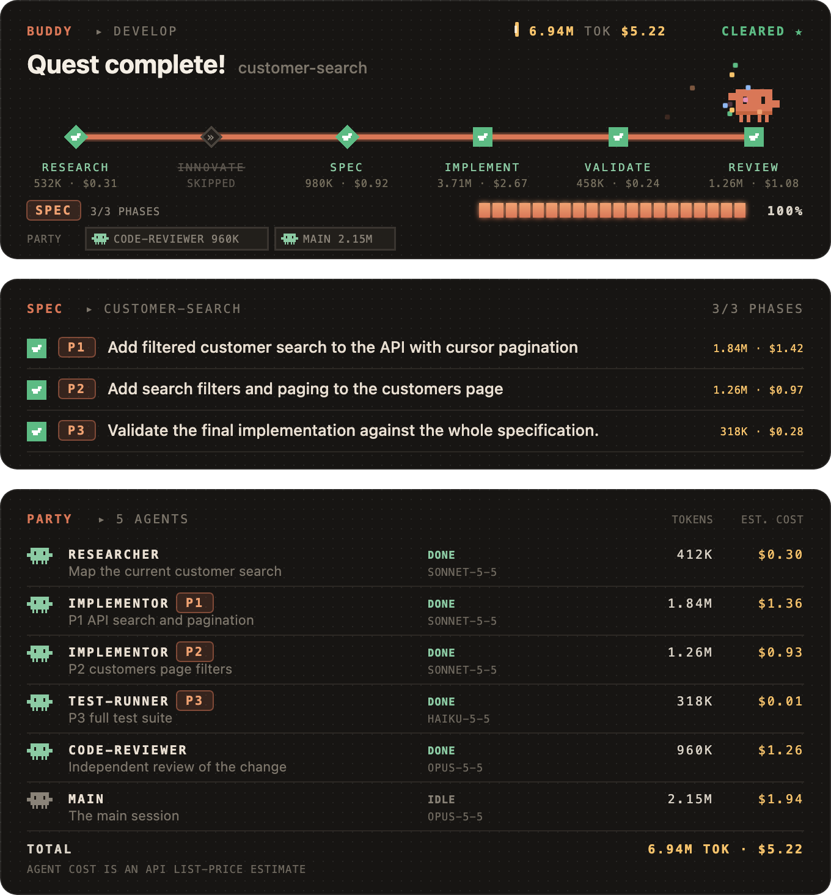

<h1 align="center">Buddy</h1>

<p align="center">
  <strong>Plan the work. Control the context. Ship with proof.</strong><br>
  A development workflow plugin for Codex, Claude Code, and Cursor that matches the work to the right planning, review, and verification steps.
</p>

<p align="center">
  <a href="https://github.com/leszekgruchala/buddy/releases"></a>
  <a href="#install-and-update"></a>
  <a href="https://agentskills.io"></a>
  <a href="LICENSE"></a>
</p>

<p align="center">
  <a href="#quick-start">Quick start</a> ·
  <a href="#what-it-does">What it does</a> ·
  <a href="#install-and-update">Install</a> ·
  <a href="#usage">Usage</a> ·
  <a href="#how-it-works">How it works</a> ·
  <a href="#requirements">Requirements</a> ·
  <a href="#limits">Limits</a>
</p>

<p align="center">
  
  <br>
  <sub>The <code>develop</code> workflow. Buddy adapts its stages to the size and risk of the change.</sub>
</p>

---

Ask Buddy to `Develop customer search with filters and pagination` and it coordinates the work from research and specification through implementation, verification, and independent review. For a tiny, contained edit, it keeps the work direct and lets your host make the change without an extra review stage. As the change grows or carries more risk, Buddy adds the planning and review steps that help catch problems.

Each stage writes its result to a worklog in your repository, so the next stage starts from facts on disk instead of a long chat history. A narrow fix goes straight to implementation; larger or unclear work gets research and a spec first. Buddy scales review and verification to the change: trivial edits need no independent review, small changes get one balanced review, and substantial changes use the full workflow.

## Quick start

Install Buddy in Claude Code directly from GitHub. Run both commands in your terminal.

```bash
claude plugin marketplace add leszekgruchala/buddy@main
claude plugin install buddy@buddy
```

Run `/reload-plugins` in Claude Code or start a new session. Then try this prompt in your project.

> Develop customer search with filters and pagination

Buddy uses the models your coding tool already offers.

<details>
<summary><strong>Install with the Buddy CLI</strong></summary>

Use this option to manage Buddy across coding tools. It requires Node.js 22.12 or later and installs from GitHub.

```bash
npm install --global github:leszekgruchala/buddy#main
buddy install --agent claude
```

Then run `/reload-plugins` or start a new Claude Code session. If npm skips lifecycle scripts, follow **Run the CLI from a checkout** under [Install and update](#install-and-update).

</details>

For Codex, Cursor, updates, and local checkouts, see [Install and update](#install-and-update).

## What it does

| Skill | What you get | Try |
|---|---|---|
| [`develop`](skills/develop/SKILL.md) | A complete change, from research to verified and reviewed code. An independent judge settles the spec's choices, so Buddy asks you only before an irreversible breaking change that you did not request, or when no option fits your constraints. | `Develop customer search with filters and pagination` |
| [`brainstorm`](skills/brainstorm/SKILL.md) | A discussion that tests an idea, kept in one living document. | `Brainstorm a neighborhood tool-sharing service with me` |
| [`research`](skills/research/SKILL.md) | A short brief of verified facts, evidence, open questions, and rejected ideas. Buddy tests the premise of your request and keeps looking past the first plausible answer. No code changes. | `Research how customer search currently works` |
| [`innovate`](skills/innovate/SKILL.md) | The best viable solution directions, their trade-offs, and a recommendation, added to a passed research brief. | `Compare ways to add pagination to customer search` |
| [`spec`](skills/spec/SKILL.md) | A phased plan with the options it compared, requirements, success criteria, and verification. | `Create a spec for customer search with filters and pagination` |
| [`judge`](skills/judge/SKILL.md) | An independent ruling on each choice in a spec: confirm, overturn, ask for more evidence, or ask you about an irreversible breaking change or a constraint conflict. `develop` runs it on each spec before implementation. | `Judge the choices in .ai/worklog/20260804_customer-search/spec_customer-search.md` |
| [`implement`](skills/implement/SKILL.md) | A narrow fix, or one approved spec run with verification. | `/implement .ai/worklog/20260804_customer-search/spec_customer-search.md` |
| [`write-tests`](skills/write-tests/SKILL.md) | Unit and integration tests for distinct behaviors that extend your existing test helpers and tables and stay inside module boundaries. | `Write tests for the discount rules` |
| [`test-runner`](skills/test-runner/SKILL.md) | The relevant tests, lint, type checks, and builds, run and reported. | `Run the tests affected by my change` |
| [`review-code`](skills/review-code/SKILL.md) | Independent, evidence-backed findings for a local change. | `/review-code` |
| [`change-report`](skills/change-report/SKILL.md) | An HTML report that explains a PR or branch diff and its impact. | `Use change-report to explain PR #123 and its impact` |
| [`archive-worklogs`](skills/archive-worklogs/SKILL.md) | Old worklogs moved into yearly archive folders. | `Archive worklogs older than 30 days` |

### See progress live in Claude Code

<p align="center">
  
  <br>
  <sub>The Buddy mod after a <code>develop</code> run, with the details pane open.</sub>
</p>

When a Buddy skill runs in Claude Code, a band above the prompt shows:

- the stage track from Research to Review, with skipped stages marked;
- the spec phase in work and a progress bar from its tasks;
- the subagents working on the stage;
- tokens and cost for the run, per stage and per phase, plus the run's total cached reads.

When detailed usage is available, token counts show new tokens: input, output, and cache writes. Cached reads are shown apart, because each request reads the whole cached conversation again, and their sum grows with the number of requests, not with the work done. The cost still includes them. If an agent reports only a total, Buddy keeps that total without estimating a split.

Select **Details**, or run `/buddy-mod`, to open a pane with every phase, its task checklist, and each subagent's tokens with its estimated cost. Input, output, and cached token counts appear when reported. **Hide** removes the band until the next Buddy run. The mod reads only events Claude Code already reports and adds nothing to your prompts or context.

<details>
<summary><strong>Turn the Buddy mod off or on</strong></summary>
<br>

The mod is on by default, also when you update an installed Buddy. To turn off only the mod, set the Buddy option **Show the Buddy mod** to off. Buddy's skills, agents, and hooks keep working. Use one of these:

- In a Claude Code terminal session, run `/plugin configure buddy@buddy`, or change the **Show the Buddy mod** row in `/config`. Claude Code reloads Buddy with the new value when you save.
- From your shell, run the command below. Claude Code applies it in your next session, in the terminal and in the Desktop app.

```bash
echo '{"show_mod":"false"}' | claude plugin configure buddy@buddy --values-stdin
```

To turn the mod on again, set the option back to on, or run the same command with `"true"`. `claude plugin install` reports this option as `not yet set` until you choose a value; the mod stays on until then. To turn off all mods, use [the mod controls](https://code.claude.com/docs/en/plugins/mods/overview#turn-mods-on-or-off).

</details>

### Explain a code change

[`change-report`](skills/change-report/SKILL.md) turns a pull request or branch diff into a short HTML report: what changed, why, who is affected, and which actions matter.

> Use change-report to compare branch feature/customer-search with main

Reports group changes by feature in a **Before / After / Impact** table with source evidence. **High risk**, **Breaking change**, and **Human review** markers show what needs attention and the next action. When wiring or execution flow changes, **Before / After** diagram tabs and an **Execution flow** view show the affected connections; small changes skip diagrams. Reports work offline and are saved in the change's `.ai/worklog/` folder.

[Open the interactive sample report](https://gruchala.eu/buddy/examples/change-report.html), or [get its self-contained HTML file](docs/examples/change-report.html) for local use. The sample is a frozen development example.

### Review and learn from findings

Run `/review-code` for an independent review of a local change. It returns findings with severity, evidence, and a fix, and does not edit your code. `develop` chooses review effort by scope and risk. A trivial change (about 30 lines or fewer in one area, with no behavior, security, or public-contract impact) stays with the host and skips independent review. A small, narrow behavior change gets implementation followed by one balanced review, with frontier review reserved for security-sensitive work. Substantial work uses the full workflow. For small changes, Buddy repeats review only after a Medium-or-higher finding is fixed; a Low-only rereview is optional and requires a cost note and your choice. Requests such as “no review,” “just change the text,” or “quick fix” suppress review and subagents for that request. When a fix is confirmed, the reviewer can add a short prevention rule to `.ai/memory/memory.md` that later specs and implementations read as advice. Worktrees of a repository share these rules.

### Destructive-command guard

Buddy bundles a shell guard that stops a short list of commands that are hard or impossible to undo before they run:

- Terraform and OpenTofu changes, and Kubernetes and Helm deletions.
- Deletions on AWS, Google Cloud, and Azure.
- Destructive SQL, database drops, and database resets such as `prisma migrate reset` or `rails db:drop`.
- Forced or deleting Git pushes, `git reset --hard`, `git clean -f`, and other Git commands that discard history.
- GitHub repository, release, and API deletions, and package publishing.
- Docker volume deletion, disk erasing and formatting, and `crontab -r`.
- Recursive removal of a root, home, current, or parent directory, such as `rm -rf ~`.

What happens next depends on your coding tool:

- **Claude Code and Cursor** ask you to approve the command. If you approve, it runs. If you decline, or nobody can approve it, such as in a headless run, the agent stops and gives you the exact command to review and run yourself. If you let your tool approve commands automatically, for example with Cursor's auto-run, it also approves these.
- **Codex** cannot ask from a hook yet, so the guard blocks the command, and the agent gives you the exact command to run yourself.

All other commands run normally, including heredocs, file removal inside your project, and commands the guard cannot read.

The guard prevents accidents. It is not a sandbox: it does not check scripts or programs that a command starts. To limit what agents can change, use your coding tool's sandbox and permission settings.

The guard runs on macOS 10.15 or newer and needs `zsh` and `jq`. If `jq` is missing, the guard blocks shell commands until you install it.

To check that the guard is active, ask the agent to run `terraform apply -help`. Buddy should ask for approval, or block it in Codex, before Terraform starts. In Codex, the guard runs only after you review and trust Buddy's hook. In Cursor Cloud Agents, the guard might not run, because Cursor does not yet document plugin hooks as available there.

## Install and update

Use the Buddy CLI for installation, updates, removal, and diagnostics across all three coding tools. It keeps the selected source for later updates. The CLI is the command reference:

```bash
buddy --help
buddy install --help
```

`buddy doctor --agent all` checks harnesses in parallel with a shared four-second timeout. A stalled check reports what it was waiting for alongside the other harness results.

To test a snapshot of this checkout instead of GitHub `main`:

```bash
buddy install --agent codex --from .
buddy update --agent codex
```

Local Claude Code installs require version 2.1.289 or later. Refresh the snapshot after editing Buddy's skills, agents, or hooks.

Existing local Buddy installations keep their marketplace names and plugin settings when adopted. Codex and Claude source directories stay intact; an existing Cursor copy gets a full backup before refresh. Later updates use the selected checkout. A copied installation with no recorded checkout needs `install --from .` once to attach its source. Disabled Claude local plugins can refresh in place. Codex refresh stops if its native command would enable a disabled plugin.

To change a recorded checkout or switch between GitHub and local sources, preview the change with `install --from <source> --migrate --dry-run`, then remove `--dry-run` to apply it. Migration preserves Codex and Claude plugin identities. Their local `buddy@buddy-local` installations cannot switch to GitHub's `buddy@buddy` identity automatically; the CLI reports the required native action before changing anything. Cursor source changes require native UI completion; the CLI reports any remaining local copy.

<details>
<summary><strong>Run the CLI from a checkout</strong></summary>

In the Buddy checkout, install dependencies and link the `buddy` command. npm builds the CLI automatically:

```bash
npm ci
npm link
buddy install --agent claude --from .
```

Keep the checkout while the command is linked. Run `npm run build` after changing the CLI source.

If your npm configuration disables lifecycle scripts, run `npm run build` after `npm ci` and before `npm link`.

</details>

After installation or update, complete these steps (the Buddy CLI also reports them):

- **Claude Code:** Reload plugins or start a new session.
- **Codex:** Start a new session and review/trust Buddy's hooks with `/hooks`, including after updates.
- **Cursor:** Complete marketplace plugin changes in the native UI, reload the window, and start a new chat. A marketplace install can take precedence over a local copy; organization policy can block local plugins.

<details>
<summary><strong>Use the official harness CLIs: install, update, inspect, and remove</strong></summary>

These alternatives install directly from GitHub `main` without the Buddy CLI. The examples use the `buddy` marketplace; existing `buddy-local` installations have a separate source and identity. Keep their qualified plugin name when maintaining them, or use the Buddy CLI's local checkout workflow above.

**Claude Code** ([official reference](https://code.claude.com/docs/en/plugins/cli-reference.md))

Install from GitHub using the [Quick start](#quick-start).

Update the marketplace, then the installed plugin:

```bash
claude plugin marketplace update buddy
claude plugin update buddy@buddy --scope user
```

Inspect with `claude plugin list`. To remove Buddy, run `claude plugin uninstall buddy@buddy --scope user --keep-data`. The data directory stays, but uninstalling the last scope removes saved plugin options and secrets.

**Codex** ([official reference](https://developers.openai.com/plugins/build/plugins#add-a-marketplace-from-the-cli))

Use a CLI with `plugin add` and `plugin remove` support (verified on version 0.169.0).

Install from `main`:

```bash
codex plugin marketplace add leszekgruchala/buddy --ref main
codex plugin add buddy@buddy
```

Update the Git marketplace and its installed plugins:

```bash
codex plugin marketplace upgrade buddy
```

Inspect with `codex plugin list --marketplace buddy`. To remove Buddy and its local cache, run `codex plugin remove buddy@buddy`. Start a new session and review/trust the updated hooks with `/hooks`.

**Cursor** ([official reference](https://cursor.com/docs/plugins))

Register the Git marketplace from `main`:

```bash
cursor-agent plugin marketplace add https://github.com/leszekgruchala/buddy --git-ref main
```

Then open **Customize**, find Buddy in the marketplace, and select **Install**. The CLI registers the marketplace; it does not install the plugin into your running Cursor session.

Refresh the marketplace index:

```bash
cursor-agent plugin marketplace update https://github.com/leszekgruchala/buddy
```

Complete any plugin update in **Customize**, reload the window, and start a new chat. Inspect registered marketplaces with `cursor-agent plugin marketplace list` and check the installed plugin in **Customize**.

To remove Buddy, use **Customize**. To unregister its marketplace afterward, run `cursor-agent plugin marketplace remove https://github.com/leszekgruchala/buddy`. Leave the marketplace registered if it is shared or still needed; unregistering it is separate from uninstalling Buddy.

</details>

<details>
<summary><strong>Automation and local state</strong></summary>

- CLI state lives in `~/.buddy/cli`. `BUDDY_HOME` selects another Buddy root; CLI state then lives in `$BUDDY_HOME/cli`. Keep the same root for later operations. The Claude Code mod uses Claude-managed state.
- Adoption, replacement, and removal can leave backups in `~/.buddy/cli/backups` (or `$BUDDY_HOME/cli/backups`). The CLI reports the paths and keeps the backups after success or rollback. Close any editors using old plugin files before removing backups you no longer need.
- If Cursor is on a different filesystem from `BUDDY_HOME`, its previous copy stays in `~/.cursor/plugins/buddy-cli-backups`, outside local plugin discovery.
- Dry-run uses saved Buddy CLI state to preview commands. It labels adoption steps that still need native verification.
- Exit codes: `0` applied/planned, `1` error, `2` manual action required, `130` cancelled. Inspect each agent's result after a partial failure.

</details>

<details>
<summary><strong>Load the live checkout for one session</strong></summary>

These native options do not create a persistent Buddy CLI installation:

```bash
claude --plugin-dir "$(pwd)"
cursor-agent --plugin-dir "$(pwd)"
```

</details>

## Usage

Describe the result you want and let `develop` coordinate the work:

> Develop customer search with filters and pagination

For the best results:

1. **Describe the outcome, not the steps.** `develop` picks the stages the task needs. Trivial edits stay direct; small changes get a focused implementation and review; substantial changes get the full pipeline.
2. **Let the judge decide.** Buddy checks that research tested your premise and compared the best options. Then an independent judge, on a frontier model with a fresh context, verifies the facts behind each choice in the spec and confirms or overturns it. It asks you only before an irreversible breaking change that you did not request and that has no reversible alternative (for example a deprecation or a feature flag), or when every option breaks one of your stated constraints. Otherwise it decides on the evidence, and picks the option easiest to undo when the evidence ties. Buddy then implements, validates, reviews, and fixes until the work passes. If your coding tool stops mid-run, Buddy's hook tells it to continue.
3. **Read the decisions at the end, or approve the spec yourself.** The final report lists each judge ruling and the fact that would change it. Buddy also stops for an action that needs your permission (for example push, publish, or a pull request), when it makes no progress, or when the environment fails; it never pushes or publishes on its own. To approve the spec yourself, add `Stop for spec approval.` to your request. For unattended runs, also let your tool approve routine tool calls, for example Claude Code's auto mode.
4. **Reuse a task list.** Write the tasks in a file and pass it: `Develop everything in @tasks.md`. Buddy turns the list into one spec. For a routine that you repeat, save it as your own skill ([Claude Code](https://code.claude.com/docs/en/skills), [Codex](https://developers.openai.com/codex/skills), [Cursor](https://cursor.com/docs/skills)); skills run as commands in all three tools.
5. **Run one stage when that is all you need.** `research`, `innovate`, `spec`, and `implement` stop after their own stage. Clarifications stay in that request; new requests are routed by their own scope. Ask for research when you need only facts, or for a spec when you want to approve the plan before code changes.
6. **Run an approved spec later.** Each piece of work has a folder in `.ai/worklog/`. Pass its spec to `/implement` to build it in a new session, or to `develop` to also get validation, review, and fixes. Buddy skips research and planning for a spec you pass, and returns to them only for a material choice that the spec leaves open.
7. **Name a model only when you care.** Buddy recommends a fast, balanced, or frontier tier per stage and your tool picks the model. Your request overrides that:

   > Develop customer search with filters and pagination. Use MODEL for review.

   See [Model selection](docs/workflow.md#model-selection) for the full rules.

Buddy writes tests the way a careful maintainer does, both in `write-tests` and when `implement` or `develop` changes code. It reads your existing tests first and adds one case per distinct behavior, failure, or edge case, not one per input that takes the same path. When a function gains an argument, it extends your shared helper or case table instead of copying tests. It skips obvious cases such as accessors and framework guarantees. Tests for generic code stay free of consumer-specific cases, and integration tests cover how parts work together without repeating the unit cases. Before it finishes, Buddy checks the test diff as a whole: new test code follows your patterns, setup repeated across new tests moves into a shared helper, names and data agree with the change, and nothing duplicates what exists. `review-code` reports added tests that break these rules. Buddy leaves your existing tests in place unless you ask it to delete or rewrite them: it reports redundant tests, changes only what a behavior change forces, and names each change. Where practical, it breaks the new behavior once to prove that a test fails. A passing test run alone does not complete a change that edits tests. In a `develop` run, the independent review also reports test deletions and rewrites that you did not ask for. Valid passing checks carry across agents and verification stages; required repository checks still apply. See [Testing and evidence reuse](docs/workflow.md#testing-and-evidence-reuse).

## How it works

- [`skills/`](skills): one Agent Skills folder per stage. [`develop`](skills/develop/SKILL.md) coordinates the others.
- [`agents/`](agents): `code-reviewer`, the independent reviewer, and `judge`, the independent decision maker for specs. The main agent does the rest itself unless a subagent helps: independent parallel work, a large search that returns a short answer, or bulk work for a cheaper model. Those subagents are ordinary ones that load the matching Buddy skill.
- [`hooks/`](hooks): the destructive-command guard and the hook that continues an active Buddy run, shared by all three tools.
- [`claude/buddy-mod/`](claude/buddy-mod): the Claude Code progress mod.
- [docs/workflow.md](docs/workflow.md): stage contracts, research and spec formats, review rules, and model selection.
- [docs/harness-compatibility.md](docs/harness-compatibility.md): what each tool supports.

Buddy writes these files to your project:

| Path | Contents |
|---|---|
| `.ai/worklog/<yyyyMMdd>_<work-name>/` | Research brief, spec, change reports, and run state for one piece of work. |
| `.ai/worklog/archive/<yyyy>/` | Worklogs moved by `archive-worklogs`. |
| `.ai/memory/memory.md` | Prevention rules confirmed by code review. |
| `docs/brainstorming/<YYYY-MM-DD>-<idea-slug>.md` | One living document per brainstormed idea. |

## Requirements

| Requirement | Needed by | Notes |
|---|---|---|
| Codex, Claude Code, or Cursor | Buddy | Install from each tool's plugin marketplace. |
| macOS 10.15 or newer | Destructive-command guard | |
| `zsh`, `jq` | Destructive-command guard, run continuation | Without `jq`, the guard blocks shell commands and Buddy runs do not continue on their own. |
| Claude Code v2.1.287 or later (terminal), v2.1.286 or later (Desktop app) | Buddy mod | Codex and Cursor do not load the mod. |
| Python 3 | `change-report`, `archive-worklogs` | Uses only the standard library. |
| Node 22.12 or later, npm, Git | Buddy CLI | npm installs the command from GitHub. |

## Limits

- Buddy provides workflow guardrails, not a security boundary. Your coding tool's sandbox, permissions, and approval system remain authoritative.
- In Cursor Cloud Agents, the destructive-command guard might not run.
- The Buddy mod shows only in a Claude Code session displayed on its own, not in a split-view pane. Subagent costs are estimates at API list prices; the run total comes from Claude Code's own session cost.
- `develop` runs at most five fix and re-review rounds, and each round must close a finding or add evidence. Otherwise it stops as blocked and reports the open findings.
- The continuation hook continues a run at most 30 times between your replies, and only while the run makes progress. It continues only the session that works on the run, so other sessions in the same project stop normally. In Cursor it works in the desktop app; its behavior in the `cursor-agent` CLI is not verified.
- Completed `develop` follow-ups can be reclassified as work evolves. Trivial follow-ups do not require a spec amendment. Tests for affected behavior run first for small or trivial changes; substantial changes and shared-code changes run their full relevant test set at the end.
- Cursor can refuse a Goal request. Buddy then tracks the run with a checklist. See [Cursor Goal tracking](docs/workflow.md#cursor-goal-tracking) for controls and opt-out.
- If a requested model or tier cannot run in your tool, Buddy reports it and does not substitute another.

## Contributing

Report bugs and ideas in [GitHub issues](https://github.com/leszekgruchala/buddy/issues). See [releases](https://github.com/leszekgruchala/buddy/releases) for what changed in each version.

## License

[Apache License 2.0](LICENSE). See [NOTICE](NOTICE) for attribution.
